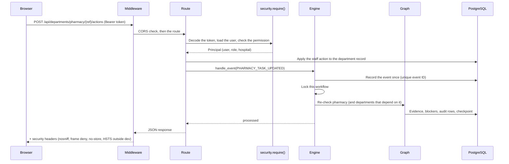

# Backend

The backend is one Python package, `backend/app`, that runs in three roles: the **API** (`uvicorn app.main:app`),
a **worker** (`python -m app.worker`) and the **HL7 listener** (`python -m app.integrations.mllp`). This page
lists the modules, follows a request through the system, and explains error handling and configuration.

## Modules

| Area | Module | Responsibility |
| --- | --- | --- |
| Start-up | `main.py` | Builds the FastAPI app: settings checks, database engine, Redis, the LangGraph checkpointer, the embedded worker, security headers, error handlers, routers |
| Settings | `config.py` | Every setting (`CAREFLOW_*`), read from `.env` and the environment. See [environment variables](../reference/generated/environment-variables.md) |
| Database | `db.py`, `dburl.py`, `models.py` | Async engine and pool, URL handling for local PostgreSQL and Neon, all tables |
| Persistence helpers | `repo.py` | Human-readable codes (WF-2041, EV-1042), audit rows, agent-run rows, evidence rows |
| Security | `security.py` | Roles and permissions, password hashing (bcrypt), password policy, JWT and OIDC tokens, `require(permission)` |
| Engine | `engine.py` | Turns events and approval decisions into graph runs: idempotency, per-workflow locks, deferral and replay |
| Agent workflow | `agents/graph.py` | The LangGraph graph and its nodes |
| Department checks | `agents/checks.py` | Deterministic rules per department that produce findings and evidence |
| LLM agents | `agents/llm_agents.py`, `llm.py` | Planner, Analyzer, Resolution Planner, Reporter; Groq backend, rate limit, timeouts, fallbacks |
| Policy | `policy.py` | The action catalog, forbidden actions and the policy check |
| Safety | `redaction.py` | Removes patient identifiers before any prompt leaves the process; detects instructions hidden in documents |
| Departments | `departments.py`, `sim.py` | Department record format, staff actions, and the store of department records |
| Knowledge | `rag.py`, `knowledge/*.md` | Standard operating procedures (SOPs) searched with BM25, with versions and expiry |
| FHIR | `fhir.py` | FHIR R4 client for importing patients |
| Events | `events.py`, `worker.py` | Redis Streams consumer group, retries, dead-letter stream |
| Integrations | `integrations/hl7.py`, `mllp.py`, `service.py`, `outbound.py` | HL7 parsing and ACKs, MLLP listener, inbound processing, signed outbound webhooks and HL7 |
| Performance | `cache.py`, `checkpoint.py`, `dbstats.py` | Director dashboard cache, self-healing checkpointer pool, per-request SQL counter |
| Administration | `cli.py`, `seed.py` | `create-admin`, `reset-password`, `load-examples`, `sync-beds`; test data |
| Telemetry | `telemetry.py` | Optional OpenTelemetry and LangSmith hooks |

API routes live in `backend/app/api/`:

| File | Endpoints |
| --- | --- |
| `routes.py` | Sign-in, workflows, approvals, audit, agents, analytics, events, knowledge, health |
| `hospital.py` | First-run setup, users, patients, discharge authorization and close, department queues and actions, reports |
| `integrations.py` | HL7 over HTTPS, JSON connectors, integration keys, status, message log, beds |
| `executive.py` | Director dashboard and its cache statistics |

The full list with permissions is generated: [API endpoints](../reference/generated/api-endpoints.md).

## Life of a request

1. **Middleware** adds CORS and security headers. With `CAREFLOW_DB_STATS=true` it also counts SQL statements per
   request (for benchmarking only).
2. **Authentication.** `security.current_principal()` verifies the JWT (or an OIDC token) and loads the user. Every
   principal carries a hospital (tenant) ID, and every query filters by it.
3. **Authorization.** `require("permission")` refuses the request with 403 unless the role has the permission.
   Department actions also check the department permission (`dept:pharmacy`, ...).
4. **Work.** The route reads and writes through an `AsyncSession`. Actions that change a workflow go through the
   engine, never straight to the graph.
5. **Response.** JSON with camelCase field names.

## Events become graph runs

`Engine.handle_event()` in `backend/app/engine.py` is the one entry point:

- It inserts the event into `workflow_events`. The unique key `(tenant, event_id)` makes a repeated event a
  no-op ("duplicate").
- An unknown patient is recorded as "ignored".
- `CLINICAL_DISCHARGE_AUTHORIZED` creates the workflow and starts the graph.
- A department event re-checks that department, unless an approval is pending. In that case the event is stored as
  "deferred" and replayed when the decision is made.
- `PATIENT_DISCHARGED` closes the workflow.

Approvals use `Engine.decide()`, which records the decision and resumes the paused graph with
`Command(resume=...)`.

## Error handling

| Situation | What happens |
| --- | --- |
| Bad input | 422 with a readable list of the invalid fields |
| Not signed in / no permission / not found / conflict | 401 / 403 / 404 / 409 with a clear message |
| Too many sign-ins or messages | 429 (Redis rate limit) |
| Locked account | 423 |
| Unexpected error | Logged with a stack trace; the client gets 500 *"Something went wrong on the server"*, with CORS headers so the browser shows the message |
| LLM down, slow, rate-limited or invalid output | The agent's deterministic fallback runs; the run is recorded with `mode=fallback` |
| Department system unreachable | Three attempts with back-off, then a *System unreachable* blocker with evidence |
| Integration message invalid | HL7 `AE`/`AR` acknowledgement or a 4xx JSON error, logged in `integration_messages` |
| Database connection closed while idle (for example by Neon) | Idle connections are checked before use and replaced; the checkpointer uses a self-healing pool |

Every error response has the same shape: `{"error": {"status": <code>, "message": "<text>"}}`.

## Configuration

Settings come from environment variables with the `CAREFLOW_` prefix, the repository-root `.env`, and the
working-directory `.env`. A blank value counts as unset. Outside `dev`, the API refuses to start without a strong
JWT secret (32+ characters) or with `*` as a CORS origin. The full list:
[environment variables](../reference/generated/environment-variables.md).

## Related pages

- [Architecture overview](overview.md) · [Agents and the graph](agents.md) · [Events and Redis](events-and-redis.md)
- [Security design](security-design.md) · [API endpoints](../reference/generated/api-endpoints.md)
