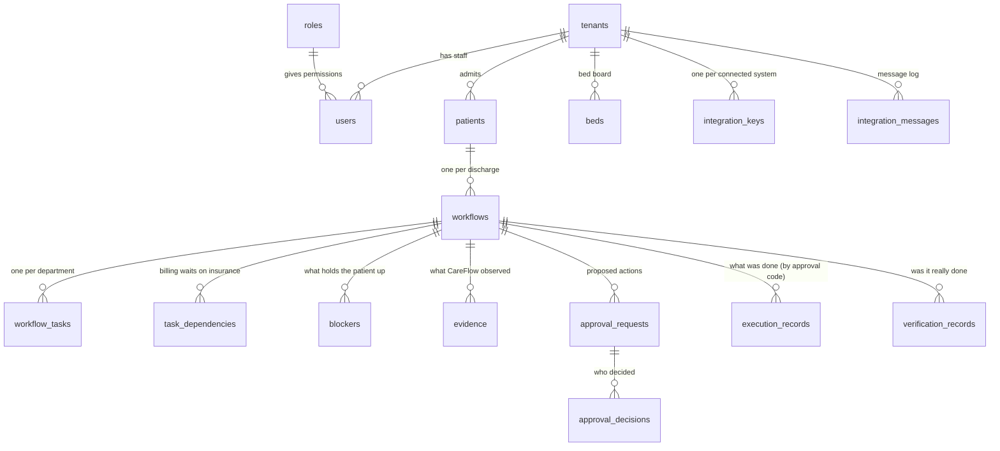

# Data model

All CareFlow data lives in one PostgreSQL database: 21 application tables defined in `backend/app/models.py`, plus
four tables LangGraph creates for the agents' saved progress. This page groups the tables by purpose, shows how
they relate, and explains where patient identity is stored and how migrations work.

The full column list and the generated diagram are on [database schema](../reference/generated/database-schema.md).

## How the main tables relate



Every table that holds hospital data has a `tenant_id` (or belongs to a workflow that has one), and every query is
filtered by the signed-in user's hospital.

## Tables by purpose

| Group | Table | Purpose | Written by |
| --- | --- | --- | --- |
| **Hospital and people** | `tenants` | The hospital (name, slug) | First-run setup, `create-admin` |
| | `roles` | The 10 roles and their permissions, kept in step with the code at every start-up | API start-up |
| | `users` | Staff accounts: email, bcrypt password hash, role, active flag, failed sign-ins, lock time, last sign-in | Users page, setup, CLI |
| **Patients and departments** | `patients` | Patients: name, MRN, ward, bed, payer, payment type, attending doctor, consent, status, source (manual, FHIR, HL7) | Admission, FHIR import, HL7/HIS connector |
| | `sim_department_records` | Each department's record for a patient (the JSON the checks read and staff actions change) | Admission, department queues, connectors, executed actions |
| | `beds` | Bed board: ward, bed, status (available, occupied, cleaning, blocked), current patient | Admission, transfer, discharge, Beds page |
| **Discharge workflow** | `workflows` | One discharge clearance: code (WF-…), status, authorized by and when, cleared and discharged times, summary | Engine and graph |
| | `workflow_tasks` | One task per department in the workflow, with status and owner | Graph |
| | `task_dependencies` | Which department waits for which | Graph (`plan`) |
| | `blockers` | Open and resolved blockers: kind, summary, evidence codes, since, resolved at | Graph (`analyze`, `verify`) |
| | `evidence` | Every observation: source, query, value seen, time, untrusted flag | Graph (`check_department`, `verify`) |
| | `workflow_events` | Every event received, once (unique per hospital and event ID), with its outcome (processed, duplicate, deferred, ignored, failed) | Engine |
| **Actions and approvals** | `approval_requests` | Proposed actions (AC-…): action, parameters, risk, approver role, status, evidence | Graph (`resolve`) |
| | `approval_decisions` | Who approved, rejected or asked for information, with comment | Approvals |
| | `execution_records` | What was executed, idempotency key, result | Graph (`execute`) |
| | `verification_records` | The re-read after each execution and whether the change was found | Graph (`verify`) |
| **Audit and monitoring** | `audit_logs` | The audit trail (AU-…): who or what did what, when, with evidence | Everything that changes a workflow |
| | `agent_executions` | Every agent run: agent, mode (llm, fallback, deterministic), latency, tokens, errors | LLM agents and checks |
| **Integrations** | `integration_keys` | One key per connected system (only a SHA-256 hash and a prefix are stored) | Integrations page |
| | `integration_messages` | Log of every inbound and outbound message: system, type, control ID, status, detail, raw text | HL7 listener, connectors, outbound delivery |
| **Internal** | `code_counters` | Counters for readable codes (WF, BL, AC, EV, AU); audit and evidence codes are reserved in blocks | `repo.py` |
| **Agent checkpoints** (created by LangGraph) | `checkpoints`, `checkpoint_blobs`, `checkpoint_writes`, `checkpoint_migrations` | The graph's saved state per workflow, so a paused workflow resumes after a restart | LangGraph |

## Where patient identity is stored

| Stored with identity | Not stored with identity |
| --- | --- |
| `patients`: name and MRN (masked for the Auditor role in every response) | Prompts sent to the LLM: identifiers are removed first |
| `integration_messages.raw`: the original HL7 or JSON text, which contains names | Agent checkpoints: the graph state carries the patient reference (`pt-…`), not the name or MRN |
| `beds`: the current patient's reference | `agent_executions`, `evidence` and `audit_logs` text pass through pattern redaction (phone and ID numbers) before saving |
| `users`: staff names and emails | |

!!! warning "Not built yet"
    Encryption at rest, a retention period and a purge job aren't built. Records stay until deleted by hand. Plan
    disk encryption and backup encryption at the server level (see [Backups](../operations/backups.md)).

## Codes you see in the app

| Code | Table | Example | How it's numbered |
| --- | --- | --- | --- |
| `WF-` | workflows | WF-2041 | One at a time, no gaps |
| `BL-` | blockers | BL-301 | One at a time, no gaps |
| `AC-` | approval_requests | AC-502 | One at a time, no gaps |
| `EV-` | evidence | EV-1042 | Reserved in blocks of 25 per process (gaps after a restart are normal) |
| `AU-` | audit_logs | AU-9012 | Reserved in blocks of 50 per process (gaps after a restart are normal) |

## Migrations

The schema is managed by Alembic (`backend/alembic/`). The API container runs `alembic upgrade head` every time it
starts, so upgrades apply automatically. Existing migrations:

| Migration | What it adds |
| --- | --- |
| `f787a1be8520_initial_schema` | The original tables |
| `dd1484a87746_real_use_patient_status_discharge_and_…` | Patient status, discharge fields, real-use changes |
| `b7e2c4d91a10_integrations_beds_director_security` | Integration keys and messages, beds (with backfill), lockout columns on users |

To add a migration after changing `models.py`:

```bash
cd backend
alembic revision --autogenerate -m "short description"   # review the generated file before committing
alembic upgrade head
```

Alembic uses the **direct** database connection even when the app uses Neon's pooled one (`dburl.py: direct_url()`).
In development (`CAREFLOW_ENV=dev`) the API also creates missing tables on start-up.

## Related pages

- [Database schema](../reference/generated/database-schema.md) · [Architecture overview](overview.md)
- [Backend](backend.md) · [Security design](security-design.md)
