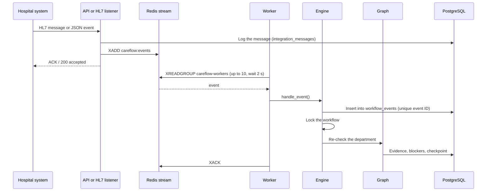

# Events and Redis

Updates from hospital systems travel through a Redis stream to the workers, which run the agent workflow. Redis
also holds locks, rate-limit counters and the Director dashboard cache. This page explains each use, what happens
when something fails, and how to scale.

## Where Redis is used

| Use | Redis keys | Code |
| --- | --- | --- |
| Event stream for hospital-system updates | `careflow:events` (stream), consumer group `careflow-workers` | `events.py` |
| Dead-letter stream for events that failed 3 times | `careflow:events:dlq` | `events.py` |
| One run per workflow at a time, across processes | `careflow:lock:<workflow code>` | `engine.py: Engine.lock()` |
| Rate limits per minute: sign-ins 10 per address, approval decisions and re-checks 30 per user, `/api/events` 120 per user, HL7 and each connector 600 per hospital | `careflow:rl:<key>:<minute>` | `api/routes.py: rate_limit()` |
| Director dashboard cache (15 s per hospital) | `cf:exec:<hospital>:v<n>:overview:<days>d`, `cf:v:exec:<hospital>`, `cf:stats:hit`/`miss` | `cache.py` |

Actions people take in the web app **don't** go through the stream: they run inline so the person sees the result
at once (see [Architecture overview](overview.md#two-ways-work-enters-the-system)).

## The event stream

The sender gets its acknowledgement as soon as the message is logged and queued; it doesn't wait for the agents.

### Message fields

| Field | Meaning |
| --- | --- |
| `event_id` | Unique ID. Used to ignore duplicates (`workflow_events` has a unique key on hospital + event ID) |
| `type` | One of the [event types](../reference/generated/event-types.md), e.g. `PHARMACY_TASK_UPDATED` |
| `tenant` | Hospital slug |
| `patient_ref` | CareFlow's patient reference (`pt-…`) |
| `occurred_at` | When it happened in the source system (ISO 8601) |
| `correlation_id` | Links related events; defaults to the event ID |
| `payload` | JSON: department, the update, who made it |
| `attempt` | 1 for the first try, then 2 and 3 |
| `error` | Only on the dead-letter stream: why the last attempt failed |

The stream is capped at about 100,000 messages (`MAXLEN ~ 100000`).

### Retries and the dead-letter stream

1. A worker reads a message and calls `Engine.handle_event()`.
2. On success it acknowledges the message (`XACK`).
3. On failure it **re-publishes the event with `attempt + 1`** and acknowledges the original.
4. After the third failed attempt the event goes to `careflow:events:dlq` with the error, for a person to inspect.

### Idempotency

The same event can arrive twice (a sender retries, or the stream re-delivers). `workflow_events` has a unique key on
`(hospital, event_id)`; the second insert fails and the engine returns *duplicate* without running anything. A
retry of an event that **failed** part-way is allowed through. HL7 messages are also de-duplicated earlier, by their
control ID (MSH-10).

### Locks and deferral

- **Locks.** Before a graph run, the engine takes an asyncio lock (within one process) and a Redis lock
  `careflow:lock:<code>` (across processes; held at most 300 s, waits up to 120 s). Two updates for the same patient
  therefore never run at once, even on different workers.
- **Deferral.** If the workflow is paused for an approval, a department event is stored as *deferred* instead of
  run. As soon as the approval run finishes, deferred events are replayed as one re-check.

## When something is down

| What fails | What happens | What to do |
| --- | --- | --- |
| **Redis down at start-up** | The API logs `Redis unavailable` and runs without it: integration updates are processed inline in the receiving process, there are no cross-process locks, rate limits or dashboard cache | Start Redis and restart the API, workers and HL7 listener |
| **Redis fails while running** | Publishing and the workers' reads fail; workers log the error and retry every 2 s; senders get an error | Restore Redis; senders should retry |
| **A worker crashes mid-event** | That message stays claimed by the dead consumer and **isn't picked up again** (no `XAUTOCLAIM` yet). The other worker carries on with new messages | Re-send the update from the source system, or press **Re-check now** on the workflow |
| **An event keeps failing** | 3 attempts, then the dead-letter stream | Read `careflow:events:dlq`, fix the cause, re-send |
| **PostgreSQL down** | Every request and graph run fails; events fail and are retried, then dead-lettered | Restore PostgreSQL; re-send dead-lettered events |
| **Groq down or rate-limited** | Agents use their deterministic fallbacks; nothing stops | None needed; runs show `mode=fallback` |
| **Neon closes idle connections** | Idle connections are checked before reuse and replaced; the checkpointer pool replaces closed connections | None needed |

!!! warning "Not built yet"
    Automatic recovery of messages held by a crashed worker (`XAUTOCLAIM` of pending entries) and a metrics endpoint
    for queue length, lag and dead letters aren't implemented. Check them with `redis-cli`:
    `XPENDING careflow:events careflow-workers` and `XLEN careflow:events:dlq`.

## The Director dashboard cache

The dashboard is read by several people and polls every 15 seconds, so its aggregates are cached per hospital for
15 seconds (`CAREFLOW_EXECUTIVE_CACHE_SECONDS`, with a little random jitter). Closing a discharge bumps a version key
so the next view is fresh. If many viewers miss at once, one rebuilds and the others wait briefly for its result. If
Redis errors, the dashboard is read straight from PostgreSQL. **Nothing else is cached:** workflow state, approvals,
department records and the audit trail are always read from the database.

## Scaling

- **More workers:** run more `worker` containers (`deploy: {replicas: N}` in `docker-compose.yml`). They share the
  consumer group, so each event goes to exactly one worker, and the Redis lock keeps one run per workflow.
- **More API processes:** fine behind the same Redis and PostgreSQL (`docker-compose.prod.yml` runs 2 Uvicorn
  workers). Keep `processes × (CAREFLOW_DB_POOL_SIZE + CAREFLOW_DB_MAX_OVERFLOW)` under PostgreSQL's connection limit.
- **Free cloud plans** have no separate workers: set `CAREFLOW_EMBEDDED_WORKER=true` so the API consumes events itself.

## Related pages

- [Architecture overview](overview.md) · [Backend](backend.md) · [Agents and the graph](agents.md)
- [Event types](../reference/generated/event-types.md) · [Environment variables](../reference/generated/environment-variables.md)
