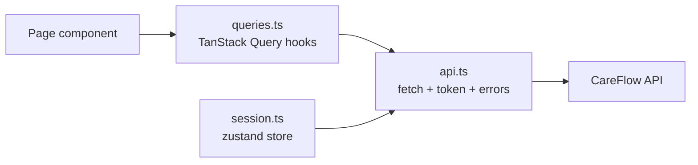

# Frontend

The web app in `web/` is a Next.js 16 application (React 19, TypeScript, Tailwind CSS 4). It has no database of its
own: every screen reads from and writes to the [API](../reference/generated/api-endpoints.md). This page lists the
pages, explains the data layer and sessions, and describes the design conventions.

## Pages

| Route | Page | Who sees it (permission) | Component |
| --- | --- | --- | --- |
| `/setup` | First-run setup (only while no users exist) | Anyone, once | `app/setup` |
| `/login` | Sign in | Anyone | `components/login.tsx` |
| `/` | Discharge board: every authorized patient, stuck ones first | `workflow:read` | `components/board.tsx` |
| `/workflows/[id]` | One workflow: departments, blockers, evidence, timeline, actions | `workflow:read` | `components/workspace.tsx`, `clearance-rail.tsx`, `timeline.tsx` |
| `/workflows/[id]/report` | Printable clearance report | `workflow:read` | `components/report.tsx` |
| `/patients` | Admit, search, edit, authorize discharge, discharged list | `workflow:read` (admit: `patient:write`; authorize: `discharge:authorize`) | `components/patients.tsx` |
| `/queue` | Department work queues with action buttons | any `dept:*` or `dept:read` | `components/queue.tsx` |
| `/beds` | Bed board by ward | `workflow:read` (change: `bed:manage`) | `components/beds.tsx` |
| `/approvals` | Approve, reject, request information | `approval:decide` | `components/approvals.tsx` |
| `/director` | Director dashboard | `executive:read` | `components/director.tsx` |
| `/operations` | Analytics, blockers, agent runs, CSV export | `analytics:read` | `components/operations.tsx` |
| `/audit` | Audit trail | `audit:read` | `components/audit.tsx` |
| `/integrations` | Connected systems, keys, HL7 test console, message log | `integration:read` (keys and console: `integration:write`) | `components/integrations.tsx` |
| `/users` | Users, roles, password resets, unlock | `user:manage` | `components/users.tsx` |
| `/account` | Change your own password | Signed in | `app/account` |

The sidebar (`components/app-shell.tsx`, list `NAV`) shows only the pages the signed-in role has permission for.
Hiding a link is a convenience, not security: the API checks the permission on every request.

## Data layer

| File | What it does |
| --- | --- |
| `web/src/lib/api.ts` | One function per endpoint. Adds the `Authorization: Bearer` header, turns the API's `{"error": {...}}` into a readable message, signs the user out on a 401, and shows *"Can't reach the CareFlow server"* when the request can't be made at all |
| `web/src/lib/queries.ts` | TanStack Query hooks for every screen, with polling and cache invalidation after a change |
| `web/src/lib/session.ts` | The signed-in user and token (zustand) |
| `web/src/lib/types.ts` | TypeScript types matching the API responses |
| `web/src/lib/format.ts` | Labels and formatting: department names, blocker labels (`KIND_LABEL`), risk labels, durations |

**Live updates are by polling**, not push:

| Data | Refreshed every |
| --- | --- |
| Discharge board, workflow, patients, department queues, approvals, beds, audit | 5 seconds |
| Integrations page | 10 seconds |
| Director dashboard, operations dashboard, agent runs | 15 seconds |

After any change the user makes, the affected queries are refreshed at once.

**API address.** `NEXT_PUBLIC_API_BASE` (default `http://localhost:8000/api`) is fixed when the app is built. With
`CAREFLOW_API_ORIGIN` set at build time, the web server forwards `/api/*` to the backend, so the browser talks to a
single origin and no CORS setup is needed.

## Sessions

- Signing in returns a JWT. The token is kept in the browser's **sessionStorage**, so closing the tab ends the
  session.
- A 401 from the API signs the user out and returns to the sign-in page.
- The token's lifetime is set by the server (`CAREFLOW_JWT_TTL_MINUTES`). There is no refresh token: after it
  expires, the user signs in again.

## Design conventions

- **Glass panels** on a soft background, one teal accent colour.
- **Status colours always mean the same thing** (`components/ui.tsx`): cleared (teal-green), in progress (blue),
  blocked (amber), awaiting approval (purple). Errors use coral. Status is also written as text, never shown by
  colour alone.
- **Risk** of an action is a labelled chip (low, medium, high).
- Phone layout: below a medium width the sidebar becomes a **☰** menu.
- Buttons state what they do (*Patient has left: close discharge*, *Mark clean*).

## Related pages

- [Architecture overview](overview.md) · [Backend](backend.md) · [Security design](security-design.md)
- [Roles and permissions](../reference/generated/roles-and-permissions.md)
