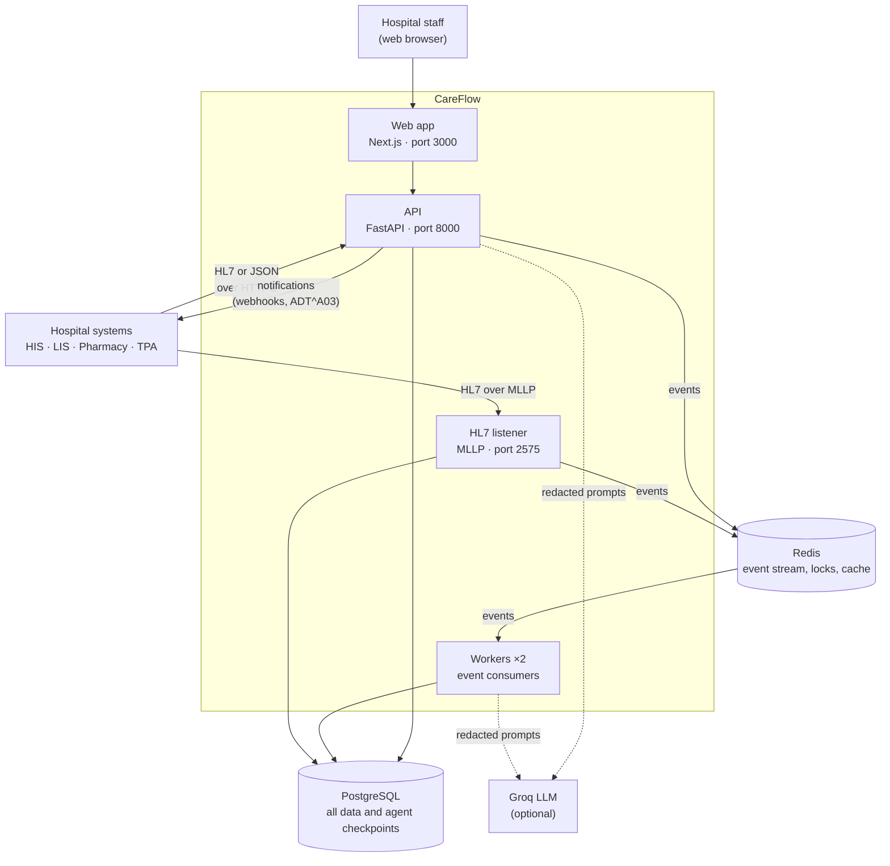
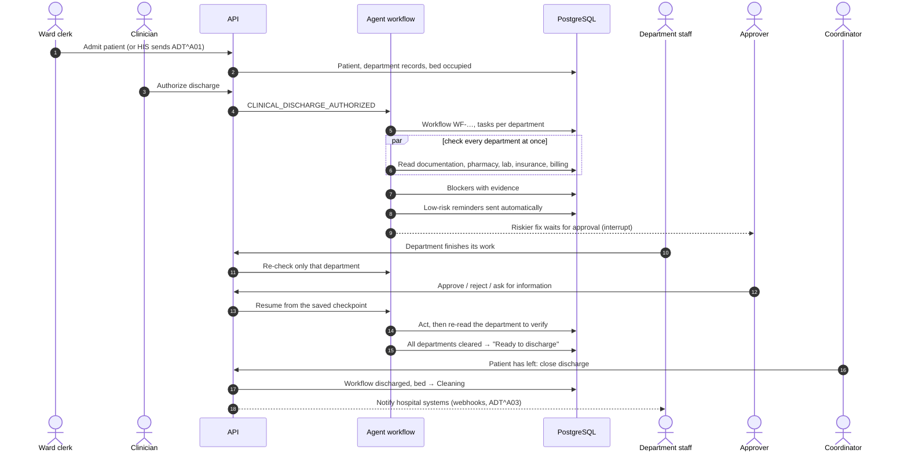
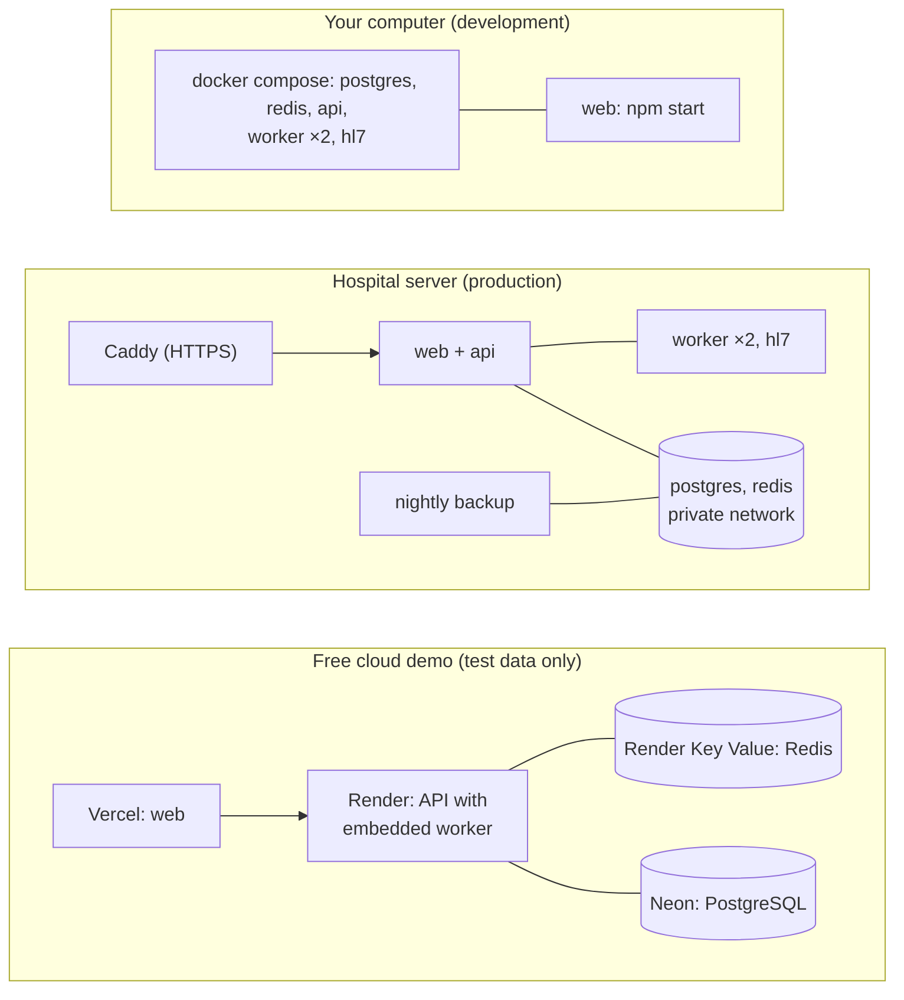

# Architecture overview

This page explains how CareFlow is put together: the parts, what each one does, how they talk to each other, and
why it is designed this way. It is for a new engineer and for a hospital IT lead reviewing the system. The other
pages in this section go deeper into each part.

## The parts at a glance

| Part | Technology | What it does | Code |
| --- | --- | --- | --- |
| **Web app** | Next.js 16, React, TanStack Query | The screens staff use. Polls the API every 5 seconds for live boards. Holds no data of its own. | `web/src/` |
| **API** | Python, FastAPI, SQLAlchemy (async) | Sign-in and permissions, every screen's data, staff actions, and running the agent workflow for actions people take. | `backend/app/main.py`, `backend/app/api/` |
| **Agent workflow** | LangGraph | The discharge-clearance process as a graph: plan, check departments in parallel, find blockers, propose fixes, pause for approval, act, verify, report. Runs inside the API and the workers. | `backend/app/agents/graph.py` |
| **Workers** (2) | Python, Redis Streams | Take updates from hospital systems off the event stream and run the agent workflow for them. | `backend/app/worker.py`, `backend/app/events.py` |
| **HL7 listener** | Python asyncio (MLLP) | Receives HL7 v2 messages on TCP port 2575, answers with an ACK, and hands the update on. | `backend/app/integrations/mllp.py` |
| **PostgreSQL** | PostgreSQL 16 (or Neon) | The single source of truth: patients, workflows, blockers, evidence, approvals, audit trail, users, beds, integration log, and the agents' saved progress (checkpoints). | `backend/app/models.py` |
| **Redis** | Redis 7 | The event stream for hospital-system updates, locks so only one process works on a workflow at a time, sign-in rate limits, and a 15-second cache for the Director dashboard. Optional: without it, updates are processed straight away in the receiving process. | `backend/app/events.py`, `engine.py`, `cache.py` |
| **Groq LLM** | Groq API (free tier) | Four agents use it to plan, analyse, choose fixes and write summaries. Optional: without a key every agent uses its built-in rules. | `backend/app/llm.py`, `agents/llm_agents.py` |

!!! info "What the LLM may and may not do"
    The LLM can explain, rank and choose among options. It cannot invent a blocker without evidence, choose an action
    outside the [action catalog](../reference/generated/action-catalog.md), or take any clinical or financial
    decision. Plain Python code (`backend/app/policy.py: check()`) makes the final decision on every action.

## One discharge, end to end

1. **Admission.** A patient is admitted by hand or by the hospital system (HL7 `ADT^A01`). CareFlow creates a work
   record for each department the patient needs and marks the bed occupied.
2. **Authorization.** Only a clinician can authorize discharge. This creates the workflow and starts the graph.
3. **Checks.** The graph reads every needed department in parallel. Each finding records the exact query and the
   value seen ([evidence](../concepts/evidence.md)).
4. **Blockers and fixes.** The graph turns findings into blockers, proposes a fix for each from the action catalog,
   and runs the policy check. Low-risk reminders happen automatically; riskier fixes pause the graph until the
   right person decides.
5. **Updates.** Each department update (a click in a queue, or a message from its system) re-checks only that
   department and the ones that depend on it.
6. **Verification.** After every write, CareFlow reads the department's system again. If the change isn't there,
   it opens an *action not applied* blocker for a person.
7. **Close.** When every department is cleared, the patient is *Ready to discharge*. A coordinator closes the
   discharge when the patient leaves; the bed goes to *Cleaning* and the hospital systems are notified.

## Two ways work enters the system

| Path | Used for | How it flows | Why |
| --- | --- | --- | --- |
| **Inline** | Anything a person clicks in the web app (authorize, department action, approval, close) | API → engine → graph, in the same request | The person sees the result straight away |
| **Through the event stream** | Updates from hospital systems (HL7, JSON connectors, `/api/events`) | API or HL7 listener → Redis stream → a worker → engine → graph | Bursts of messages are queued and retried; a slow agent run never blocks the sender |

Both paths go through the same `Engine.handle_event()` (`backend/app/engine.py`). It records every event once
(duplicates are ignored by event ID), takes a lock so only one run per workflow happens at a time, and holds
department updates while an approval is pending, replaying them as soon as it is decided. Details:
[Events and Redis](events-and-redis.md).

## How it runs

| Setup | Files | Notes |
| --- | --- | --- |
| Development | `docker-compose.yml` | Everything on one PC. The current default uses the local PostgreSQL. |
| Hospital server | `docker-compose.prod.yml`, `deploy/Caddyfile`, `deploy/backup.sh` | HTTPS, no database ports exposed, restart policies, health checks, nightly backups. See [Deployment](../operations/deployment.md). |
| Free cloud demo | `render.yaml`, Vercel | No separate workers or MLLP port on free plans: the event consumer runs inside the API, and HL7 arrives over HTTPS. Not for real patient data. |

!!! warning "Put the API next to its database"
    Each agent step makes several small database queries. With the API in India and the database in the USA, every
    query takes about 0.35 seconds, and a discharge authorization took minutes. Always run the API in the same
    region (or on the same server) as PostgreSQL.

## Why it is designed this way

| Decision | Reason |
| --- | --- |
| **Deterministic checks first, LLM on top** | Whether something blocks a discharge must be provable and repeatable. Department checks are plain Python rules that record evidence; the LLM only explains, ranks and chooses. With no LLM at all, CareFlow still works. |
| **A fixed action catalog and a Python policy check** | An agent can only *propose*. Actions outside the catalog, actions without evidence, and anything clinical or financial are refused by code, whatever a model or a document says. |
| **Human approval for risky actions** | Medium- and high-risk actions pause with LangGraph's `interrupt()` until a person with the right role decides. The pause is saved in PostgreSQL, so it survives restarts. |
| **Verify after every write** | A write that "succeeded" but changed nothing is a common integration failure. Re-reading the source system catches it. |
| **PostgreSQL as the only source of truth** | One database holds the workflow state, the audit trail and the agents' checkpoints, so a backup or restore captures everything consistently. |
| **Redis Streams, not Kafka or RabbitMQ** | Consumer groups, retries and a dead-letter stream with one small, free component that CareFlow already needs for locks. |
| **Free, open-source stack** | PostgreSQL, Redis, Caddy, Docker, MkDocs and the Groq free tier. A hospital can run CareFlow without licence costs. |
| **One process type, several roles** | The same backend image runs as the API, a worker or the HL7 listener, which keeps deployment simple. |

## Limits of the current design

The full list of what exists and what doesn't is in `docs/_audit.md`. The main limits for architecture are:

- Delays (time limits) are noticed at the next re-check of a workflow, not on a timer.
- If a worker crashes while holding an event, that event isn't reclaimed automatically (no `XAUTOCLAIM`).
- Outbound notifications retry in memory; a restart during a retry loses that attempt (it stays logged as failed).
- One hospital per deployment is the tested path, although the data model is multi-tenant.

## Related pages

- [Backend](backend.md) · [Agents and the graph](agents.md) · [Events and Redis](events-and-redis.md)
- [Data model](data-model.md) · [Frontend](frontend.md) · [Security design](security-design.md)
- Generated: [agent graph](../reference/generated/agent-graph.md), [database schema](../reference/generated/database-schema.md), [API endpoints](../reference/generated/api-endpoints.md)
