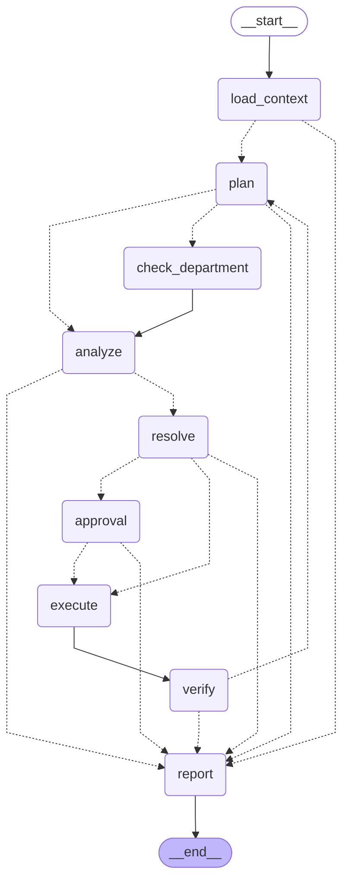

<!-- Generated by scripts/gen_docs.py — do not edit by hand -->
# Agent graph

!!! info "Generated from the code"
    Generated by `scripts/gen_docs.py` — do not edit by hand. Run the script after changing the code.

The orchestration graph compiled from `backend/app/agents/graph.py: build_graph()`, drawn by LangGraph's `get_graph().draw_mermaid()`. Dotted arrows are conditional routes.

