<!-- Generated by scripts/gen_docs.py — do not edit by hand -->
# Database schema

!!! info "Generated from the code"
    Generated by `scripts/gen_docs.py` — do not edit by hand. Run the script after changing the code.

Tables from the SQLAlchemy models in `backend/app/models.py` (`Base.metadata`). The LangGraph checkpoint tables (`checkpoints`, `checkpoint_blobs`, `checkpoint_writes`, `checkpoint_migrations`) are created by LangGraph itself and aren't shown. Migrations are in `backend/alembic/versions/`.

## Diagram

```mermaid
erDiagram
    agent_executions {
        uuid id PK
        uuid tenant_id FK
        varchar workflow_code
        varchar agent
        varchar mode
        varchar status
        text input_summary
        text output_summary
        int latency_ms
        int tokens
        int retries
        text error
        timestamptz started_at
    }
    approval_decisions {
        uuid id PK
        uuid approval_id FK
        varchar decision
        uuid reviewer_id FK
        varchar reviewer_name
        varchar reviewer_role
        text comment
        timestamptz decided_at
    }
    approval_requests {
        uuid id PK
        uuid workflow_id FK
        varchar code
        varchar blocker_code
        varchar action
        json params
        text description
        text expected_impact
        varchar risk
        bool requires_approval
        varchar approver_role
        json evidence_ids
        json sop_refs
        varchar status
        varchar decided_by
        timestamptz decided_at
        text comment
        timestamptz created_at
        timestamptz updated_at
    }
    ask_sessions {
        uuid id PK
        uuid tenant_id FK
        uuid user_id FK
        varchar title
        timestamptz created_at
        timestamptz updated_at
    }
    ask_turns {
        uuid id PK
        uuid session_id FK
        uuid tenant_id FK
        uuid user_id FK
        text question
        varchar status
        bool partial
        json plan
        json steps
        json results
        json answer
        json claims
        int latency_ms
        int tokens
        varchar model
        varchar mode
        int rating
        text feedback
        timestamptz created_at
    }
    audit_logs {
        uuid id PK
        uuid tenant_id FK
        varchar code
        varchar workflow_code
        timestamptz at
        varchar actor_kind
        varchar actor
        varchar event
        text detail
        json evidence_ids
        int latency_ms
        int tokens
    }
    beds {
        uuid id PK
        uuid tenant_id FK
        varchar ward
        varchar bed
        varchar status
        varchar patient_ref
        varchar updated_by
        timestamptz updated_at
    }
    blockers {
        uuid id PK
        uuid workflow_id FK
        varchar code
        varchar department
        varchar kind
        text summary
        timestamptz since
        json evidence_ids
        varchar waiting_on
        varchar status
        timestamptz resolved_at
        timestamptz created_at
        timestamptz updated_at
    }
    code_counters {
        varchar name PK
        int value
    }
    evidence {
        uuid id PK
        uuid workflow_id FK
        varchar code
        varchar department
        varchar source
        varchar query
        text observed
        timestamptz observed_at
        bool untrusted
    }
    execution_records {
        uuid id PK
        uuid workflow_id FK
        varchar approval_code
        varchar action
        varchar idempotency_key
        bool success
        json result
        timestamptz executed_at
    }
    integration_keys {
        uuid id PK
        uuid tenant_id FK
        varchar name
        varchar system
        varchar key_prefix
        varchar key_hash
        bool is_active
        varchar created_by
        timestamptz created_at
        timestamptz last_used_at
    }
    integration_messages {
        uuid id PK
        uuid tenant_id FK
        varchar direction
        varchar system
        varchar protocol
        varchar message_type
        varchar control_id
        varchar patient_ref
        varchar status
        text detail
        text raw
        int attempts
        timestamptz created_at
    }
    patients {
        uuid id PK
        uuid tenant_id FK
        varchar ref
        varchar encounter_ref
        varchar display_name
        varchar mrn
        varchar ward
        varchar bed
        varchar payer
        varchar payer_type
        varchar attending
        timestamptz admitted_at
        bool has_lab_orders
        bool consent_for_coordination
        varchar status
        varchar source
        timestamptz created_at
        timestamptz updated_at
    }
    roles {
        uuid id PK
        varchar name
        varchar description
        json permissions
        timestamptz created_at
        timestamptz updated_at
    }
    sim_department_records {
        uuid id PK
        uuid tenant_id FK
        varchar patient_ref
        varchar department
        json data
        timestamptz updated_at
    }
    task_dependencies {
        uuid id PK
        uuid workflow_id FK
        varchar department
        varchar depends_on
    }
    tenants {
        uuid id PK
        varchar slug
        varchar name
        timestamptz created_at
        timestamptz updated_at
    }
    users {
        uuid id PK
        uuid tenant_id FK
        varchar email
        varchar name
        uuid role_id FK
        varchar password_hash
        bool is_active
        int failed_logins
        timestamptz locked_until
        timestamptz last_login_at
        timestamptz created_at
        timestamptz updated_at
    }
    verification_records {
        uuid id PK
        uuid workflow_id FK
        varchar approval_code
        bool verified
        json observed
        timestamptz checked_at
    }
    workflow_events {
        uuid id PK
        uuid tenant_id FK
        varchar event_id
        varchar type
        varchar patient_ref
        varchar workflow_code
        varchar correlation_id
        json payload
        timestamptz occurred_at
        timestamptz received_at
        varchar status
        int attempts
        text error
    }
    workflow_tasks {
        uuid id PK
        uuid workflow_id FK
        varchar department
        varchar title
        varchar status
        varchar owner
        timestamptz source_updated_at
        timestamptz cleared_at
        int position
        timestamptz created_at
        timestamptz updated_at
    }
    workflows {
        uuid id PK
        uuid tenant_id FK
        varchar code
        uuid patient_id FK
        varchar status
        timestamptz authorized_at
        varchar authorized_by
        int iteration
        text summary
        timestamptz cleared_at
        timestamptz discharged_at
        timestamptz deleted_at
        timestamptz created_at
        timestamptz updated_at
    }
    approval_requests ||--o{ approval_decisions : "approval_id"
    ask_sessions ||--o{ ask_turns : "session_id"
    patients ||--o{ workflows : "patient_id"
    roles ||--o{ users : "role_id"
    tenants ||--o{ agent_executions : "tenant_id"
    tenants ||--o{ ask_sessions : "tenant_id"
    tenants ||--o{ ask_turns : "tenant_id"
    tenants ||--o{ audit_logs : "tenant_id"
    tenants ||--o{ beds : "tenant_id"
    tenants ||--o{ integration_keys : "tenant_id"
    tenants ||--o{ integration_messages : "tenant_id"
    tenants ||--o{ patients : "tenant_id"
    tenants ||--o{ sim_department_records : "tenant_id"
    tenants ||--o{ users : "tenant_id"
    tenants ||--o{ workflow_events : "tenant_id"
    tenants ||--o{ workflows : "tenant_id"
    users ||--o{ approval_decisions : "reviewer_id"
    users ||--o{ ask_sessions : "user_id"
    users ||--o{ ask_turns : "user_id"
    workflows ||--o{ approval_requests : "workflow_id"
    workflows ||--o{ blockers : "workflow_id"
    workflows ||--o{ evidence : "workflow_id"
    workflows ||--o{ execution_records : "workflow_id"
    workflows ||--o{ task_dependencies : "workflow_id"
    workflows ||--o{ verification_records : "workflow_id"
    workflows ||--o{ workflow_tasks : "workflow_id"
```

## Tables

### `agent_executions`

| Column | Type | Nullable | Key | References |
| --- | --- | --- | --- | --- |
| `id` | uuid | no | PK | — |
| `tenant_id` | uuid | no | FK | tenants.id |
| `workflow_code` | varchar | no | — | — |
| `agent` | varchar | no | — | — |
| `mode` | varchar | no | — | — |
| `status` | varchar | no | — | — |
| `input_summary` | text | no | — | — |
| `output_summary` | text | no | — | — |
| `latency_ms` | int | no | — | — |
| `tokens` | int | no | — | — |
| `retries` | int | no | — | — |
| `error` | text | yes | — | — |
| `started_at` | timestamptz | no | — | — |

Indexes: `ix_agent_executions_tenant_id`, `ix_agent_executions_workflow_code`. 

### `approval_decisions`

| Column | Type | Nullable | Key | References |
| --- | --- | --- | --- | --- |
| `id` | uuid | no | PK | — |
| `approval_id` | uuid | no | FK | approval_requests.id |
| `decision` | varchar | no | — | — |
| `reviewer_id` | uuid | yes | FK | users.id |
| `reviewer_name` | varchar | no | — | — |
| `reviewer_role` | varchar | no | — | — |
| `comment` | text | yes | — | — |
| `decided_at` | timestamptz | no | — | — |

Indexes: `ix_approval_decisions_approval_id`. 

### `approval_requests`

| Column | Type | Nullable | Key | References |
| --- | --- | --- | --- | --- |
| `id` | uuid | no | PK | — |
| `workflow_id` | uuid | no | FK | workflows.id |
| `code` | varchar | no | — | — |
| `blocker_code` | varchar | no | — | — |
| `action` | varchar | no | — | — |
| `params` | json | no | — | — |
| `description` | text | no | — | — |
| `expected_impact` | text | no | — | — |
| `risk` | varchar | no | — | — |
| `requires_approval` | bool | no | — | — |
| `approver_role` | varchar | no | — | — |
| `evidence_ids` | json | no | — | — |
| `sop_refs` | json | no | — | — |
| `status` | varchar | no | — | — |
| `decided_by` | varchar | yes | — | — |
| `decided_at` | timestamptz | yes | — | — |
| `comment` | text | yes | — | — |
| `created_at` | timestamptz | no | — | — |
| `updated_at` | timestamptz | no | — | — |

Indexes: `ix_approval_requests_status`, `ix_approval_requests_workflow_id`. Unique: (code).

### `ask_sessions`

| Column | Type | Nullable | Key | References |
| --- | --- | --- | --- | --- |
| `id` | uuid | no | PK | — |
| `tenant_id` | uuid | no | FK | tenants.id |
| `user_id` | uuid | no | FK | users.id |
| `title` | varchar | no | — | — |
| `created_at` | timestamptz | no | — | — |
| `updated_at` | timestamptz | no | — | — |

Indexes: `ix_ask_sessions_user`. 

### `ask_turns`

| Column | Type | Nullable | Key | References |
| --- | --- | --- | --- | --- |
| `id` | uuid | no | PK | — |
| `session_id` | uuid | no | FK | ask_sessions.id |
| `tenant_id` | uuid | no | FK | tenants.id |
| `user_id` | uuid | no | FK | users.id |
| `question` | text | no | — | — |
| `status` | varchar | no | — | — |
| `partial` | bool | no | — | — |
| `plan` | json | no | — | — |
| `steps` | json | no | — | — |
| `results` | json | no | — | — |
| `answer` | json | no | — | — |
| `claims` | json | no | — | — |
| `latency_ms` | int | no | — | — |
| `tokens` | int | no | — | — |
| `model` | varchar | yes | — | — |
| `mode` | varchar | no | — | — |
| `rating` | int | yes | — | — |
| `feedback` | text | yes | — | — |
| `created_at` | timestamptz | no | — | — |

Indexes: `ix_ask_turns_session_id`, `ix_ask_turns_tenant_id`. 

### `audit_logs`

| Column | Type | Nullable | Key | References |
| --- | --- | --- | --- | --- |
| `id` | uuid | no | PK | — |
| `tenant_id` | uuid | no | FK | tenants.id |
| `code` | varchar | no | — | — |
| `workflow_code` | varchar | no | — | — |
| `at` | timestamptz | no | — | — |
| `actor_kind` | varchar | no | — | — |
| `actor` | varchar | no | — | — |
| `event` | varchar | no | — | — |
| `detail` | text | no | — | — |
| `evidence_ids` | json | no | — | — |
| `latency_ms` | int | yes | — | — |
| `tokens` | int | yes | — | — |

Indexes: `ix_audit_logs_workflow_code`, `ix_audit_tenant_at`. 

### `beds`

| Column | Type | Nullable | Key | References |
| --- | --- | --- | --- | --- |
| `id` | uuid | no | PK | — |
| `tenant_id` | uuid | no | FK | tenants.id |
| `ward` | varchar | no | — | — |
| `bed` | varchar | no | — | — |
| `status` | varchar | no | — | — |
| `patient_ref` | varchar | yes | — | — |
| `updated_by` | varchar | no | — | — |
| `updated_at` | timestamptz | no | — | — |

Indexes: `ix_beds_tenant_id`. Unique: (tenant_id, ward, bed).

### `blockers`

| Column | Type | Nullable | Key | References |
| --- | --- | --- | --- | --- |
| `id` | uuid | no | PK | — |
| `workflow_id` | uuid | no | FK | workflows.id |
| `code` | varchar | no | — | — |
| `department` | varchar | no | — | — |
| `kind` | varchar | no | — | — |
| `summary` | text | no | — | — |
| `since` | timestamptz | no | — | — |
| `evidence_ids` | json | no | — | — |
| `waiting_on` | varchar | yes | — | — |
| `status` | varchar | no | — | — |
| `resolved_at` | timestamptz | yes | — | — |
| `created_at` | timestamptz | no | — | — |
| `updated_at` | timestamptz | no | — | — |

Indexes: `ix_blockers_workflow_id`. 

### `code_counters`

| Column | Type | Nullable | Key | References |
| --- | --- | --- | --- | --- |
| `name` | varchar | no | PK | — |
| `value` | int | no | — | — |

### `evidence`

| Column | Type | Nullable | Key | References |
| --- | --- | --- | --- | --- |
| `id` | uuid | no | PK | — |
| `workflow_id` | uuid | no | FK | workflows.id |
| `code` | varchar | no | — | — |
| `department` | varchar | no | — | — |
| `source` | varchar | no | — | — |
| `query` | varchar | no | — | — |
| `observed` | text | no | — | — |
| `observed_at` | timestamptz | no | — | — |
| `untrusted` | bool | no | — | — |

Indexes: `ix_evidence_code`, `ix_evidence_workflow_id`. 

### `execution_records`

| Column | Type | Nullable | Key | References |
| --- | --- | --- | --- | --- |
| `id` | uuid | no | PK | — |
| `workflow_id` | uuid | no | FK | workflows.id |
| `approval_code` | varchar | no | — | — |
| `action` | varchar | no | — | — |
| `idempotency_key` | varchar | no | — | — |
| `success` | bool | no | — | — |
| `result` | json | no | — | — |
| `executed_at` | timestamptz | no | — | — |

Indexes: `ix_execution_records_workflow_id`. Unique: (idempotency_key).

### `integration_keys`

| Column | Type | Nullable | Key | References |
| --- | --- | --- | --- | --- |
| `id` | uuid | no | PK | — |
| `tenant_id` | uuid | no | FK | tenants.id |
| `name` | varchar | no | — | — |
| `system` | varchar | no | — | — |
| `key_prefix` | varchar | no | — | — |
| `key_hash` | varchar | no | — | — |
| `is_active` | bool | no | — | — |
| `created_by` | varchar | no | — | — |
| `created_at` | timestamptz | no | — | — |
| `last_used_at` | timestamptz | yes | — | — |

Indexes: `ix_integration_keys_tenant_id`. Unique: (key_hash).

### `integration_messages`

| Column | Type | Nullable | Key | References |
| --- | --- | --- | --- | --- |
| `id` | uuid | no | PK | — |
| `tenant_id` | uuid | no | FK | tenants.id |
| `direction` | varchar | no | — | — |
| `system` | varchar | no | — | — |
| `protocol` | varchar | no | — | — |
| `message_type` | varchar | no | — | — |
| `control_id` | varchar | no | — | — |
| `patient_ref` | varchar | yes | — | — |
| `status` | varchar | no | — | — |
| `detail` | text | no | — | — |
| `raw` | text | no | — | — |
| `attempts` | int | no | — | — |
| `created_at` | timestamptz | no | — | — |

Indexes: `ix_integration_messages_control_id`, `ix_intmsg_tenant_at`. 

### `patients`

| Column | Type | Nullable | Key | References |
| --- | --- | --- | --- | --- |
| `id` | uuid | no | PK | — |
| `tenant_id` | uuid | no | FK | tenants.id |
| `ref` | varchar | no | — | — |
| `encounter_ref` | varchar | no | — | — |
| `display_name` | varchar | no | — | — |
| `mrn` | varchar | no | — | — |
| `ward` | varchar | no | — | — |
| `bed` | varchar | no | — | — |
| `payer` | varchar | no | — | — |
| `payer_type` | varchar | no | — | — |
| `attending` | varchar | no | — | — |
| `admitted_at` | timestamptz | no | — | — |
| `has_lab_orders` | bool | no | — | — |
| `consent_for_coordination` | bool | no | — | — |
| `status` | varchar | no | — | — |
| `source` | varchar | no | — | — |
| `created_at` | timestamptz | no | — | — |
| `updated_at` | timestamptz | no | — | — |

Indexes: `ix_patients_status`, `ix_patients_tenant_id`. Unique: (tenant_id, mrn), (tenant_id, ref).

### `roles`

| Column | Type | Nullable | Key | References |
| --- | --- | --- | --- | --- |
| `id` | uuid | no | PK | — |
| `name` | varchar | no | — | — |
| `description` | varchar | no | — | — |
| `permissions` | json | no | — | — |
| `created_at` | timestamptz | no | — | — |
| `updated_at` | timestamptz | no | — | — |

Unique: (name).

### `sim_department_records`

| Column | Type | Nullable | Key | References |
| --- | --- | --- | --- | --- |
| `id` | uuid | no | PK | — |
| `tenant_id` | uuid | no | FK | tenants.id |
| `patient_ref` | varchar | no | — | — |
| `department` | varchar | no | — | — |
| `data` | json | no | — | — |
| `updated_at` | timestamptz | no | — | — |

Unique: (tenant_id, patient_ref, department).

### `task_dependencies`

| Column | Type | Nullable | Key | References |
| --- | --- | --- | --- | --- |
| `id` | uuid | no | PK | — |
| `workflow_id` | uuid | no | FK | workflows.id |
| `department` | varchar | no | — | — |
| `depends_on` | varchar | no | — | — |

Indexes: `ix_task_dependencies_workflow_id`. Unique: (workflow_id, department, depends_on).

### `tenants`

| Column | Type | Nullable | Key | References |
| --- | --- | --- | --- | --- |
| `id` | uuid | no | PK | — |
| `slug` | varchar | no | — | — |
| `name` | varchar | no | — | — |
| `created_at` | timestamptz | no | — | — |
| `updated_at` | timestamptz | no | — | — |

Unique: (slug).

### `users`

| Column | Type | Nullable | Key | References |
| --- | --- | --- | --- | --- |
| `id` | uuid | no | PK | — |
| `tenant_id` | uuid | no | FK | tenants.id |
| `email` | varchar | no | — | — |
| `name` | varchar | no | — | — |
| `role_id` | uuid | no | FK | roles.id |
| `password_hash` | varchar | no | — | — |
| `is_active` | bool | no | — | — |
| `failed_logins` | int | no | — | — |
| `locked_until` | timestamptz | yes | — | — |
| `last_login_at` | timestamptz | yes | — | — |
| `created_at` | timestamptz | no | — | — |
| `updated_at` | timestamptz | no | — | — |

Indexes: `ix_users_tenant_id`. Unique: (email).

### `verification_records`

| Column | Type | Nullable | Key | References |
| --- | --- | --- | --- | --- |
| `id` | uuid | no | PK | — |
| `workflow_id` | uuid | no | FK | workflows.id |
| `approval_code` | varchar | no | — | — |
| `verified` | bool | no | — | — |
| `observed` | json | no | — | — |
| `checked_at` | timestamptz | no | — | — |

Indexes: `ix_verification_records_workflow_id`. 

### `workflow_events`

| Column | Type | Nullable | Key | References |
| --- | --- | --- | --- | --- |
| `id` | uuid | no | PK | — |
| `tenant_id` | uuid | no | FK | tenants.id |
| `event_id` | varchar | no | — | — |
| `type` | varchar | no | — | — |
| `patient_ref` | varchar | no | — | — |
| `workflow_code` | varchar | yes | — | — |
| `correlation_id` | varchar | no | — | — |
| `payload` | json | no | — | — |
| `occurred_at` | timestamptz | no | — | — |
| `received_at` | timestamptz | no | — | — |
| `status` | varchar | no | — | — |
| `attempts` | int | no | — | — |
| `error` | text | yes | — | — |

Indexes: `ix_workflow_events_tenant_id`. Unique: (tenant_id, event_id).

### `workflow_tasks`

| Column | Type | Nullable | Key | References |
| --- | --- | --- | --- | --- |
| `id` | uuid | no | PK | — |
| `workflow_id` | uuid | no | FK | workflows.id |
| `department` | varchar | no | — | — |
| `title` | varchar | no | — | — |
| `status` | varchar | no | — | — |
| `owner` | varchar | no | — | — |
| `source_updated_at` | timestamptz | no | — | — |
| `cleared_at` | timestamptz | yes | — | — |
| `position` | int | no | — | — |
| `created_at` | timestamptz | no | — | — |
| `updated_at` | timestamptz | no | — | — |

Indexes: `ix_workflow_tasks_workflow_id`. Unique: (workflow_id, department).

### `workflows`

| Column | Type | Nullable | Key | References |
| --- | --- | --- | --- | --- |
| `id` | uuid | no | PK | — |
| `tenant_id` | uuid | no | FK | tenants.id |
| `code` | varchar | no | — | — |
| `patient_id` | uuid | no | FK | patients.id |
| `status` | varchar | no | — | — |
| `authorized_at` | timestamptz | no | — | — |
| `authorized_by` | varchar | no | — | — |
| `iteration` | int | no | — | — |
| `summary` | text | yes | — | — |
| `cleared_at` | timestamptz | yes | — | — |
| `discharged_at` | timestamptz | yes | — | — |
| `deleted_at` | timestamptz | yes | — | — |
| `created_at` | timestamptz | no | — | — |
| `updated_at` | timestamptz | no | — | — |

Indexes: `ix_workflows_tenant_status`. Unique: (tenant_id, code).
